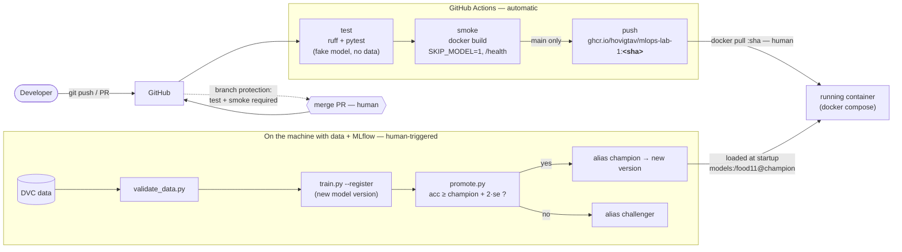

# Lab 5 — CI/CD with GitHub Actions

Repository: <https://github.com/HoviGtaV/mlops-lab-1>
Image: `ghcr.io/hovigtav/mlops-lab-1:<commit-sha>` (first one: `6c213295806833c2e9a301ced1f928041594e075`)

## What was built

| File | Purpose |
|---|---|
| `src/food11/data.py` | `CLASSES`, `category_from_filename()`, `resize_image()` as pure functions; copy loop under `if __name__ == "__main__"` |
| `src/food11/serve.py` | model kept in module-level `model`; loaded at startup unless `SKIP_MODEL` is set; `/predict` → 503 without a model, 400 for a non-image |
| `src/food11/train.py` | `--register` flag (registers the run's model as a new `food11` version); tracking URI read from `MLFLOW_TRACKING_URI` |
| `src/food11/validate_data.py` | data contract, PASS/FAIL report, exit code 1 on failure |
| `src/food11/promote.py` | champion/challenger quality gate, decision written as version tags |
| `tests/` | 14 tests: data code, API with a fake model, data contract, gate arithmetic |
| `.github/workflows/ci.yml` | `test` (ruff + pytest) → `smoke` (build + `/health` probe) → `push` (ghcr.io, `main` only) |
| `pyproject.toml` | dev group (pytest, ruff, httpx), `pythonpath = ["."]` for pytest, ruff config |

Two details worth knowing:

- `ruff` sorted `import mlflow` as a *first-party* import because the repo has an `mlflow/` folder (the Lab 4 Dockerfile). `known-third-party = ["mlflow"]` in `pyproject.toml` fixes that.
- `ghcr.io` image names must be lowercase; the workflow lower-cases `HoviGtaV/mlops-lab-1` with `${GITHUB_REPOSITORY,,}`.

---

## Question 1 — Why not load the real model in a unit test?

A unit test should check *my code*, fast and deterministically. Loading `models:/food11@champion` makes the result depend on things outside the code:

1. **No server.** The GitHub runner has no MLflow server (mine runs on my laptop / in Docker Compose), so the test fails with "connection refused" even though the code is fine.
2. **The alias moves.** Promoting a new version changes what `champion` points to. The same commit can pass today and fail tomorrow (different output format, different classes), with no code change.
3. **Missing or broken artifacts.** `docker compose down -v`, a deleted `mlartifacts/` folder, or a torch version that can't unpickle the model all break the test.
4. **Slow and flaky.** Every run downloads tens of MB of model over the network, so a timeout becomes a "test failure".

## Question 2 — What does `test_predict_returns_valid_json` prove?

**It proves** that the API accepts a multipart upload and decodes a real JPEG with PIL. It also proves that preprocessing produces one `(1, 3, 128, 128)` tensor (the fake model asserts the shape), that the model output is turned into probabilities, that index 0 maps to `"Bread"`, and that the JSON has `category` and a `confidence` in [0, 1].

**It does not prove**:
- **The model's accuracy.**
- **That training and serving preprocessing match.** A wrong normalisation would still pass.
- **That the real model returns what the code expects.** The fake returns *probabilities*, but `serve.py` assumes *logits* and applies softmax. The fake therefore gets a confidence of ≈0.17 and the test still passes, so a double-softmax bug would go unnoticed.
- **That `classes` is in the same order as the `ImageFolder` indices used in training.** (`ImageFolder` sorts folders alphabetically; the list happens to be alphabetical.)

To cover the gap, I also served the real champion (v1) locally against a copy of the registry: `bread.jpg` → Bread 0.995, an evaluation Soup → Soup 0.92, a Rice → Rice 0.92, and a non-image → 400.

## Question 3 — Which check caught the duplicate?

Check 4, **"no image in two splits"** (MD5 of the file content). It reported `training/Bread/0_0.jpg` and `evaluation/Bread/dup_0_0.jpg` as identical.

**It had already failed before I broke anything.** The mini dataset contains **43 byte-identical images across splits**: 3 evaluation images are also in training, 2 validation images are also in training, and 38 are shared between validation and evaluation. They come from the original Kaggle files, not from `data.py`. For example, `food11_raw/training/0_106.jpg` and `food11_raw/evaluation/0_131.jpg` have the same MD5 (`730837e9…`). The contract exits with code 1 on the current data, and that is the correct verdict.

**A duplicate is more dangerous than a corrupted image** because it fails silently:
- A corrupted image crashes training immediately. You notice, fix it, and lose a few minutes.
- A train/test duplicate makes the model look better than it is: it is graded on images it memorised. The inflated test accuracy then feeds the promotion gate, so the wrong model can become `champion`, and nobody sees an error.

Here the train→test leak is at most 3/1096 ≈ 0.3 accuracy points, which is small. The 38 validation/evaluation duplicates are more worrying: the run is chosen on `val_accuracy` and then reported on a test set that partly overlaps it.

## Question 4 — Where should `validate_data.py` run?

The runner can't see the data, so the check must run where the data is:

1. **Before data is versioned.** Run it before `dvc add` / `dvc push`, as a git pre-commit hook or as the first stage of a `dvc.yaml` pipeline that `train` depends on. A broken dataset then never gets a pointer committed to git.
2. **At the start of training**, on the machine that has the data (`train.py`, or the training pipeline, runs it first and stops on exit code 1). No model is ever trained on data that breaks the contract.
3. *(Optionally)* **In CI**, by giving the runner DagsHub credentials as GitHub secrets and `dvc pull`-ing the mini dataset in a separate job.

## Question 5 — What does `needs: test` do?

If a unit test fails, `smoke` is **skipped**, and so is `push`, because it needs `smoke`. PR #2 shows exactly this: `test` failing, `smoke` and `push` skipped.

Without `needs`, the jobs run in parallel. `smoke` would spend about 1.5 minutes building and probing an image from code that is already known to be broken. Worse, `push` would then depend only on `smoke`, so on `main` an image whose unit tests failed could be published to ghcr.io.

## Question 6 — How long did the runs take, and what got faster?

| Run | test job | `uv sync` | `pytest` | smoke job | `docker build` | push job (build + push) |
|---|---|---|---|---|---|---|
| 1st (branch `lab5-ci-cd`) | 29 s | 3 s | 9 s | 94 s | 73 s | skipped |
| 2nd (`main`) | 24 s | 6 s | 11 s | 100 s | 76 s | 151 s |
| 3rd (PR #2 fix) | 20 s | 5 s | 9 s | 102 s | 79 s | skipped |

Whole run ≈ 2 minutes (≈ 5 minutes on `main`, including the push job).

**Almost nothing got faster.**
- **`uv` cache.** The first run logged *"No GitHub Actions cache found"*, and later runs logged *"Cache hit … restored"*. Yet `uv` still downloaded every wheel, because `setup-uv` prunes pre-built wheels from its cache before saving: downloading them from PyPI is about as fast as restoring them. With CPU-only torch, `uv sync` takes only 3–6 s anyway, so there is little to gain.
- **`docker build` in `smoke`.** It is never cached (a plain `docker build` on a fresh runner), so it takes about 75 s every time and is the slowest step.
- **The `push` job.** It uses `cache-from/cache-to: type=gha`, so its *second* build reuses the layers. The first one took 151 s.

## Question 7 — Why tag with the commit SHA rather than `latest`?

A SHA tag is **immutable and traceable**. `ghcr.io/hovigtav/mlops-lab-1:6c21329…` is always the image built from commit `6c21329`. You can look up the exact code, reproduce the build, and roll back by naming an older SHA. `latest` is a moving label that says nothing about which code is inside.

**Concrete case.** On Monday, server A runs `docker pull …:latest` and gets commit X. On Tuesday, CI pushes commit Y as `latest`, and server B (or a newly scheduled Kubernetes pod) pulls `latest` and gets Y. Server A keeps running X, because `docker run …:latest` uses the local copy and does not pull again (Kubernetes `imagePullPolicy: IfNotPresent` behaves the same). Both machines claim to run `latest`, they answer differently, and the logs can't tell you which code produced a bad prediction.

## Question 8 — Why declare `permissions:` explicitly?

**Least privilege.** Depending on repository and organisation settings, the default `GITHUB_TOKEN` can have write access to most of the repository. The `push` job only needs to read code and write packages, so that is all it gets.

Any step can be compromised: a hijacked third-party action tag (`docker/build-push-action@v6` is a moving tag), a malicious dependency installed by `uv sync`, or a poisoned base image. With a write-everything token, such a step could:
- push a commit or tag with a backdoor to `main`
- delete branches or create a fake release
- open, approve or merge pull requests
- publish a malicious image under your name
- poison the Actions cache that later runs restore

With `contents: read` + `packages: write`, the worst it can do is publish a bad image.

## Question 9 — The broken pull request

PR #2 (`demo-broken-test`) changed `category_from_filename` to `CLASSES[class_id + 1]`.

- **What the page showed:** *"Some checks were not successful — 2 failing, 4 skipped checks"*. `ci / test` was **Failing, Required** (for both the `push` and `pull_request` events), and `smoke`/`push` were **Skipped**.
- **Could I still merge? No.** Even as the repository owner, a merge attempt was refused with HTTP 405: *Required status check "test" is failing*. The rule has "Do not allow bypassing the above settings" enabled, so admins can't merge past a red check either. ("Require approvals" is off, because a solo developer can't approve their own PR.)
- I pushed the fix to the same branch, the checks turned green, and PR #2 was merged.

**What it changes for a team.** "Run the tests before you push" depends on everyone remembering, having the same environment, and being honest. The protection rule is enforced by the server: every change to `main` is tested from scratch in the same clean environment, and the result is visible to reviewers on the PR. `main` is therefore always in a known-good state, with no "works on my machine".

## Question 10 — Quality gate results

Current champion: **v1**, trained on the mini dataset (lr = 1e-4, 5 epochs), `test_accuracy = 0.7536`. The test split (mini `evaluation`) has **n = 1096** images.

$$se = \sqrt{\frac{0.7536 \times 0.2464}{1096}} = 0.0130 \qquad 2\,se = 0.0260$$

So **`2 * se` is about 2.6 accuracy points**. A candidate must reach **≥ 0.7797** to replace the champion. A gain of 1–2 points is within noise for a test set of this size.

**Candidates** (TODO: fill in after running). Run these in the VS Code terminal, from the repo root:

```powershell
docker compose up -d mlflow          # registry at http://127.0.0.1:5000 (Lab 4)
uv sync
# candidate A: very small learning rate (expected: too weak -> challenger)
uv run python src/food11/train.py --dataset mini --epochs 5  --lr 0.00001 --batch-size 32 --register
# candidate B: best settings (champion's lr, more epochs)
uv run python src/food11/train.py --dataset mini --epochs 10 --lr 0.0001  --batch-size 32 --register
uv run python src/food11/promote.py --version 2
uv run python src/food11/promote.py --version 3
```

| Candidate | Settings | test_accuracy | Threshold | Decision |
|---|---|---|---|---|
| v2 | lr 1e-5, 5 epochs | | 0.7797 | |
| v3 | lr 1e-4, 10 epochs | | 0.7797 | |

`promote.py` also writes `gate_decision`, `gate_candidate_acc`, `gate_champion_acc`, `gate_se`, `gate_threshold` and `gate_n` as tags on each version (visible in the MLflow UI under Models → food11 → Version n).

## Question 11 — How can `promote.py` run automatically after training?

`promote.py` only needs the MLflow API (no GPU and no data, apart from the test-set size, which can be passed with `--n`). It just has to run somewhere that can reach the registry:

1. **Hosted MLflow.** Use DagsHub's MLflow server for this repo (`https://dagshub.com/<user>/mlops-lab-1.mlflow`), with the token stored as a GitHub secret (`MLFLOW_TRACKING_USERNAME/PASSWORD`). Training logs there, and a GitHub Actions job (triggered by `workflow_dispatch`, or a `repository_dispatch` sent at the end of `train.py`) runs `promote.py --version <n>` on a normal cloud runner.
2. **Self-hosted runner.** Register the lab machine as a GitHub Actions self-hosted runner. A workflow with `runs-on: self-hosted` can reach `localhost:5000`, the DVC data and the GPU, so it can run `train.py --register` followed by `promote.py`.

Simpler alternatives: call the gate at the end of `train.py --register`, make it the last stage of a `dvc.yaml` pipeline, or trigger it from an MLflow model-registry webhook on "model version created".

## Question 12 — The pipeline



| Step | Automatic? | Decides |
|---|---|---|
| lint + unit tests + smoke test on every push/PR | automatic (GitHub Actions) | — |
| merging into `main` | human, but **blocked** unless `test` and `smoke` pass | **code version** |
| building and pushing the image | automatic on `main` | image tag = **commit SHA** |
| data contract, training, registering | human-run (needs the data + MLflow) | — |
| promotion | `promote.py` applies the gate; a human starts it | **model version** (`champion` alias) |
| deploying (`docker pull …:<sha>`, `docker compose up` / `restart inference`) | human | which code + which champion is live |

The code version is fixed by the **git SHA** (the image tag). The model version is fixed by the **`champion` alias** in the registry, read when the container starts. The two are released independently: a new champion needs only `docker compose restart inference`, and a new image doesn't change the model.
